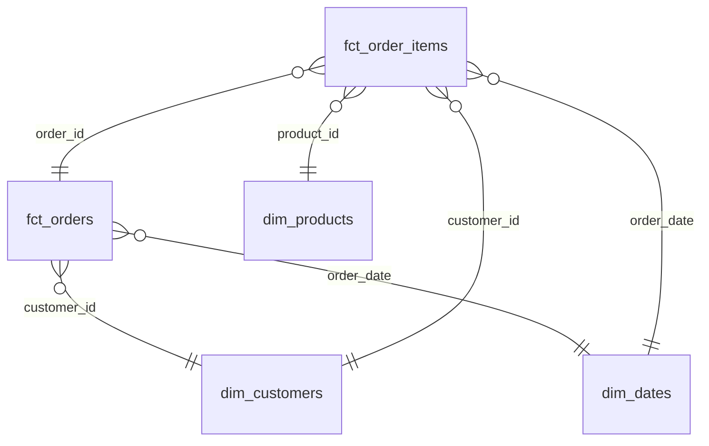
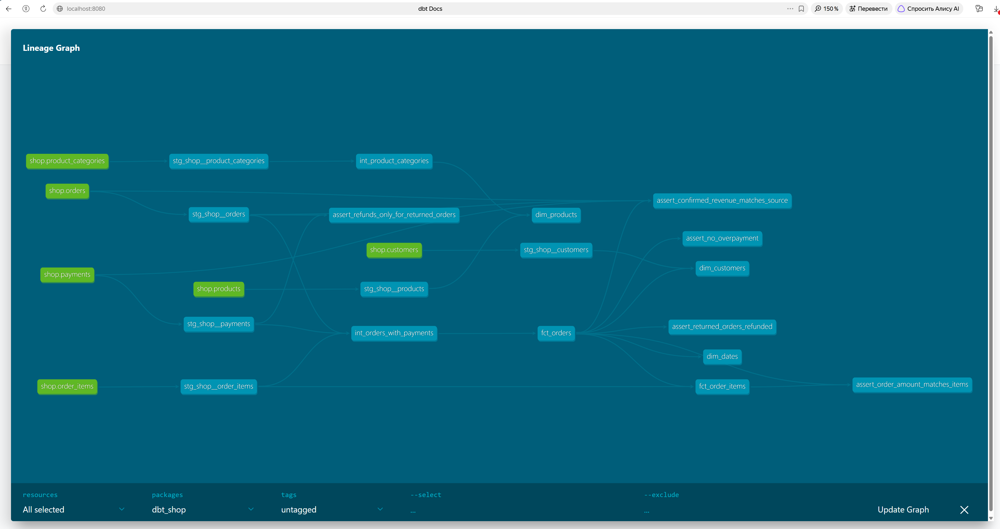

# store_hse

# Модель данных

Собрал аналитическое хранилище интернет-магазина на Greenplum с помощью dbt. Исходные данные разделил на неск. слоев обработки, а для анализа продаж создал 5 витрин по схеме Звезда

Ну то есть вместо того, чтобы каждый раз соединять кучу исходных таблиц, я заранее подготовил данные для аналитики

fct_orders - одна строка соответствует одному заказу. Тут есть стоимость заказа, инф-ция об оплате, колво разных товаров и признак подтверждённой покупки. Тестовые заказы исключил. С помощью этой таблицы можно посмотреть, сколько было заказов и какую выручку они принесли

fct_order_items - одна строка соответствует одному товару в заказе. Здесь хранятся количество, цена, скидка и итоговая стоимость позиции. можно посмотреть, какие товары покупают чаще и какую выручку они приносят магазу

dim_products - одна строка соответств. одному товару.Здесь есть название, марка, категория, категория её родителя и корневая категория (root_category_name). я отдельно разобрал уровни категорий, чтобы можно было анализировать продажи не только отдельных товаров, но и целых групп

dim_customers - одна строка соответств. одному клиенту. Причём оставлены даже те, кто пока ничего не покупал. Добавил первую подтверждённую покупку, количество заказов и общую сумму покупок. Это позволяет сравнивать покупателей из разных городов и каналов привлечения

dim_dates - одна строка соответств. одному календарному дню. В ней хранятся год, квартал, месяц, день недели и признак выходного. Т.о. можно легко сравнивать продажи в разные месяцы или в будни и выходные

# ER-диаграмма

Ниже показаны связи между нашими витринами. В центре находятся таблицы с заказами и их позициями, а остальные таблицы содержат дополнительную информацию о клиентах, товарах и датах.

# Хранение в Greenplum

Для разных витрин выбрал разные способы распределения данных. Основная идея была в том, чтобы большие таблицы с заказами распределить между сегментами, а небольшие справочники хранить целиком на каждом сегменте
 
| Витрина        | Распределение            | Хранение  | Почему выбрали                                 
|----------------|--------------------------| ----------|-------------------------------------------------
| fct_orders     | DISTRIBUTED BY (order_id)|строковое  | Распределяем заказы по их ID. 
| fct_order_items| DISTRIBUTED BY (order_id)|колончатое | Используем тот же ключ, что и у заказов. Дополнительно выбрали колоночное хранение для аналитических запросов. 
| dim_customers  | DISTRIBUTED REPLICATED   |строковое  |Клиентов немного, поэтому таблицу можно скопировать на каждый сегмент. 
| dim_products   | DISTRIBUTED REPLICATED   |строковое  | Таблица товаров небольшая, её тоже удобно хранить на каждом сегменте. 
| dim_dates      | DISTRIBUTED REPLICATED   |строковое  |Календарь содержит всего 133 дня, поэтому его размер совсем небольшой. 

Для fct_orders и fct_order_items выбрали одинаковый ключ order_id. Благодаря этому при JOIN по номеру заказа Greenplum не нужно пересылать строки между сегментами

# Граф зависимостей

Также был построен граф зависимостей в dbt Docs

На нём видно, как данные проходят через staging и intermediate, а затем используются для создания итоговых витрин

# Проверка данных

После создания витрин были добавленны тесты, чтобы проверить правильность данных

Проверялны также были уникальность идентификаторов, отсутствие пустых значений и связи между таблицами. Например, чтобы в заказах не оказалось товара, которого нет в справочнике товаров

Отдельно проверил денежные расчёты: совпадение суммы заказа с суммой его позиций; общую выручку; возвраты и возможные переплаты

# Обнаруженная проблема

При проверке обнаружил проблему с заказом 113

Стоимость заказа составляет 200 рублей, но по нему прошло два успешных платежа по 200 рублей. Получается, что покупатель заплатил 400 рублей вместо 200

Не стал исправлять исходные данные, поскольку по условию нужно было ток обнаружить эту ошибку

Для соответствующего теста установил severity='warn', чтобы dbt не выдавал ошибку при сборку, а лишь выкидывал предупреждение

# Дополнительное задание

Для дополнительного задания выбрал вариант с подключением библиотеки dbt_utils

В витрине dim_products использовал функцию generate_surrogate_key, которая создаёт хеш-ключ product_hash на основе product_id

Основной product_id при этом оставил без изменений, поэтому существующие связи с другими таблицами продолжают работать как раньше